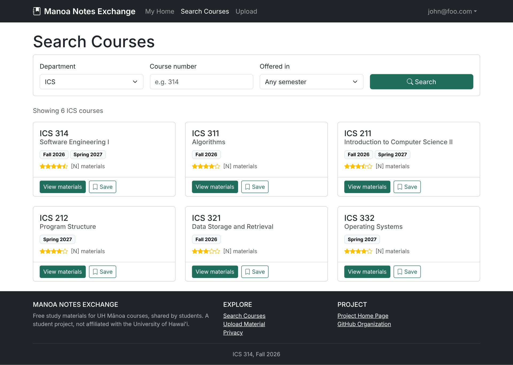
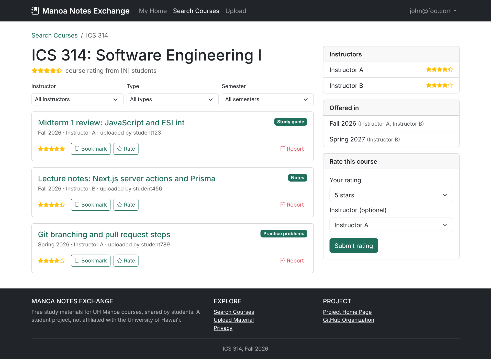
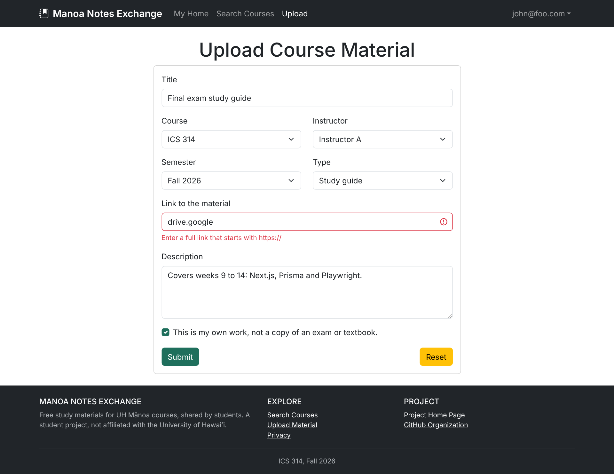
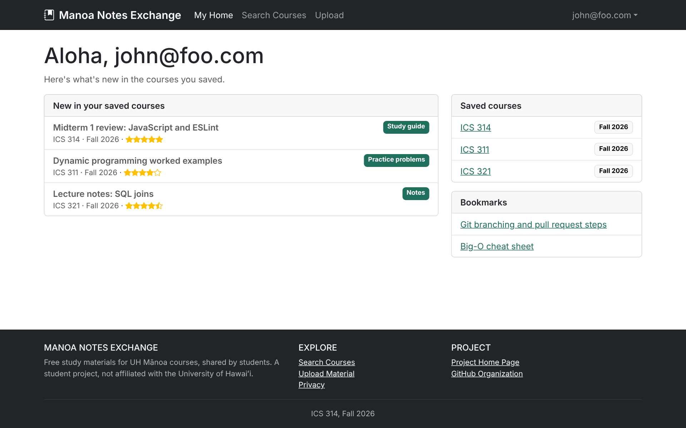
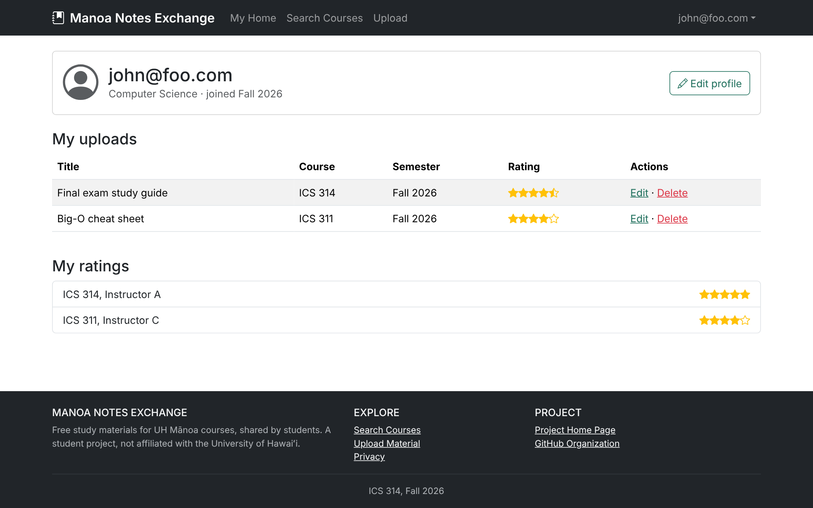
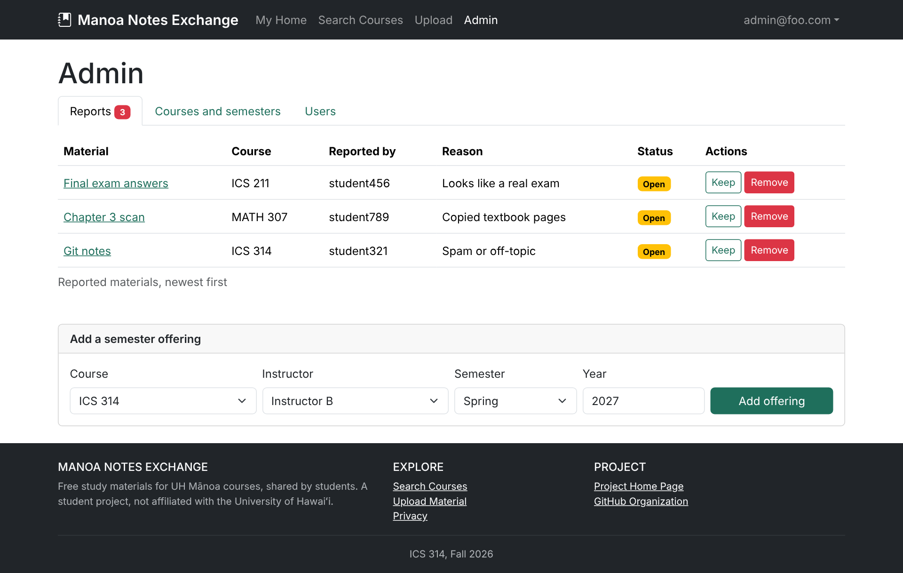

# Manoa Notes Exchange

## Table of contents

- [Overview](#overview)
- [Beyond the Basics](#beyond-the-basics)
- [Deployment](#deployment)
- [User Guide](#user-guide)
- [Developer Guide](#developer-guide)
- [Team](#team)
- [Team Contract](#team-contract)

## Overview

**The Problem:** Commercial study platforms lock peer-contributed material behind expensive paywalls and offer generic resources that do not match UH Mānoa course syllabi. As a result, UHM students waste valuable time hunting through scattered Discord channels, Google Drive links, and Lamaku course pages to find relevant study guides.

**The Solution:** An open-access, UHM-focused web application where students can centralize, search, and share course and instructor specific study materials for free. By saving their enrolled classes, students receive a personalized home feed featuring newly uploaded notes, exam reviews, and top-rated resources tailored directly to their current semester schedule.

## Beyond the Basics

* Report system so users can flag inappropriate material.
* Rating system for courses and instructors.
* Tracking system for available courses and instructors in a given semester.

## Deployment

The application will be deployed to Vercel during Milestone 1. A link will appear here once it's live.

## User Guide

This section walks through the pages planned for Manoa Notes Exchange.

**How these mockups were made:** We had Claude, an AI assistant made by Anthropic, generate the mockup pages. We gave it our project plan, the required features, and one main constraint: every page had to be rebuildable with the tools we learned in ICS 314. The mockups were revised and reviewed, then shared with the whole team for feedback before being added here. They're static HTML screenshots, not the application itself. During Milestone 1, each of us will rebuild and refine our assigned pages in Next.js. All names, courses and ratings shown are sample data.

**Checked against our class tools:** Claude checked that every Bootstrap class and icon on these pages exists in the class template's packages, with no custom styling beyond a color setting. The pages can be rebuilt with:

- **Bootstrap 5** for layout and styling (the same version our class template installs)
- **React Bootstrap** for cards, buttons, forms, tables and tabs
- **React Bootstrap Icons** for the icons and rating stars
- **Next.js and React** for the pages and components
- **TypeScript** with **ESLint** for the code and its style checks
- **PostgreSQL and Prisma** for courses, materials, ratings, reports and semester offerings
- **Auth.js** from the template for sign in, sign up, logged-in pages and the admin page
- **React Hook Form and Yup** for the upload and rating forms
- **Vercel** to deploy the app, and **Playwright** to test it

The page designs are checked. The database, login and form features are planned and haven't been built yet.

### Landing Page

The landing page is what visitors see first. It explains what the site is for and gives them a place to sign in, sign up or search for a course.

### Search Courses

Search Courses lets anyone look up a course by department, number and semester, then save courses they want to follow.

### Browse Course Material

Each course has its own page listing the shared study materials. Students can rate the course and its instructors, bookmark materials, and report anything that looks like a copied exam, textbook pages or spam.

### Upload Course Material

Logged-in students share notes, study guides and practice problems through this form, tagged by course, instructor and semester.

### User Home

After signing in, students see what's new in the courses they saved, along with their bookmarks.

### User Profile

The profile page lists a student's own uploads and ratings, with options to edit or delete them.

### Admin

Admins review reported materials and decide whether to keep or remove them, and they keep the course catalog current by adding semester offerings.

## Developer Guide

Manoa Notes Exchange is built from the ICS 314 [Next.js application template](https://github.com/ics-software-engineering/nextjs-application-template). Installation steps will be added here once the application repository is set up.

The planned data model includes Course, Instructor, Offering (a course taught by an instructor in a given semester), Material, Rating, Report, SavedCourse and Bookmark, alongside the template's User.

## Team

* Leihani ([leihanitaylortabanera](https://github.com/leihanitaylortabanera))
* Jaymond ([jayguan1048](https://github.com/jayguan1048))
* Chance ([chancekiyoshi](https://github.com/chancekiyoshi))
* Kaipono ([KaiponoRees](https://github.com/kaiponorees))
* Tomoki ([tomokicheung](https://github.com/tomokicheung))

## Team Contract

Read our [Team Contract](https://docs.google.com/document/d/13HT4GIf2RV0KWBnbKVbAqYQeWA0VdIe-L-u_Q3Eze2A/edit?usp=sharing).
