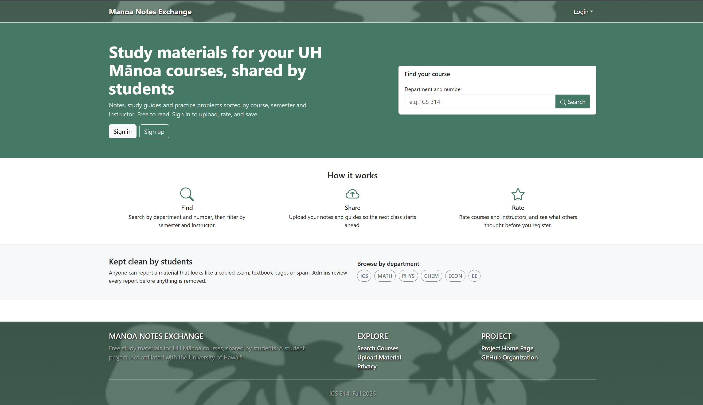
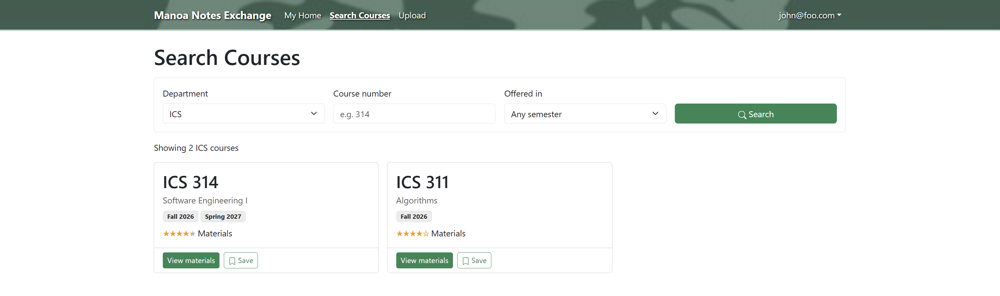
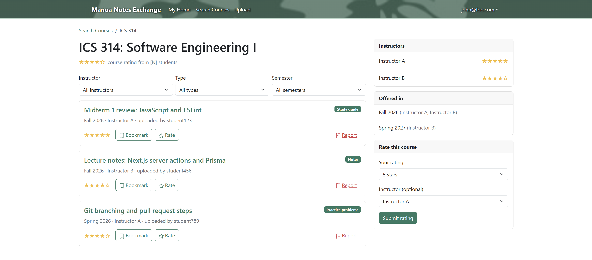
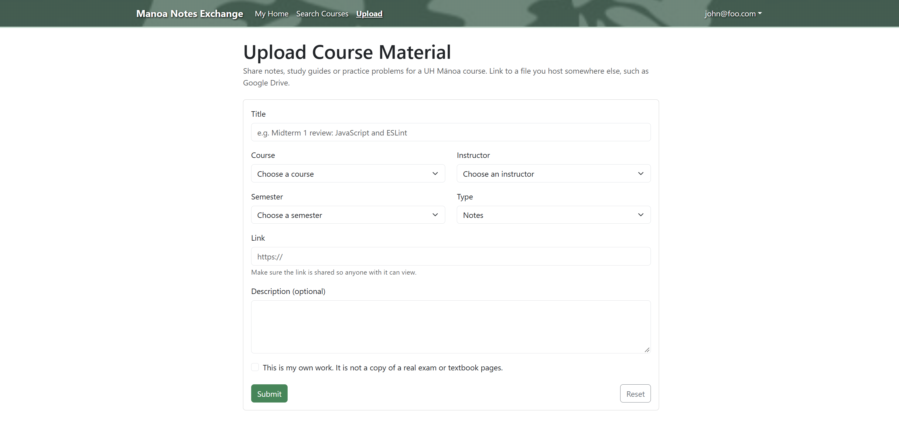
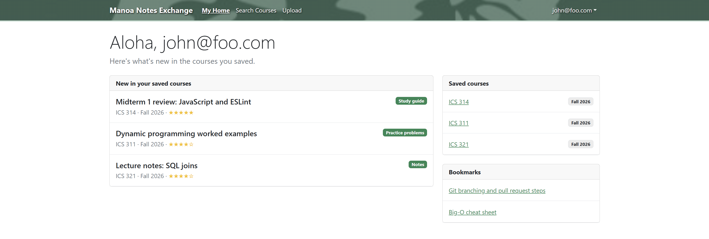
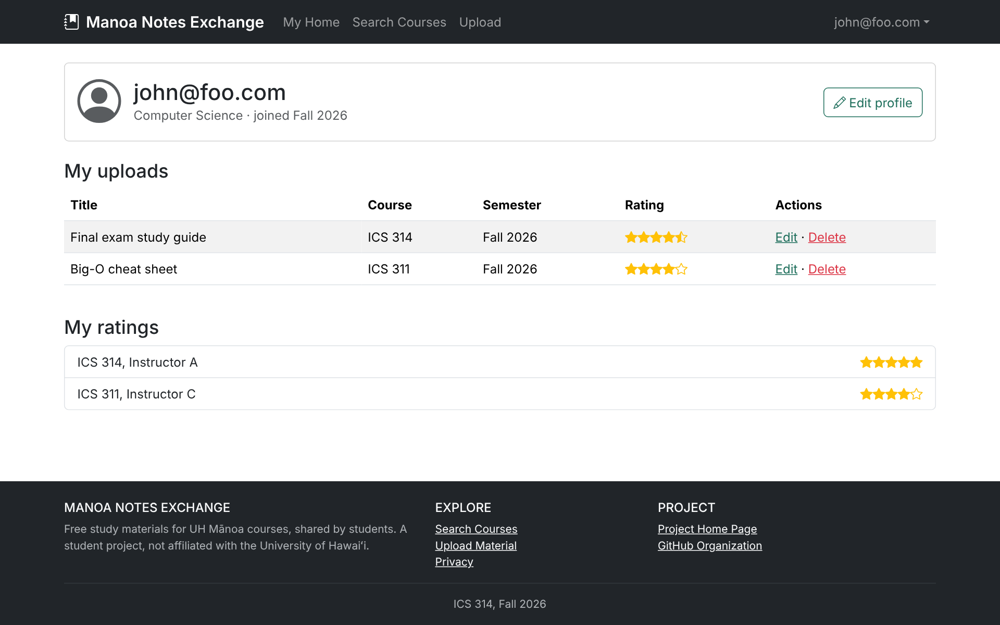
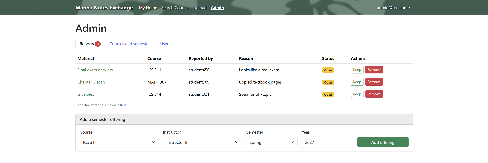

# Manoa Notes Exchange

## Table of contents

- [Overview](#overview)
- [Beyond the Basics](#beyond-the-basics)
- [Deployment](#deployment)
- [Project Management](#project-management)
- [User Guide](#user-guide)
- [Developer Guide](#developer-guide)
- [Team](#team)
- [Team Contract](#team-contract)

## Overview

**The Problem:** Commercial study platforms lock peer-contributed material behind expensive paywalls and offer generic resources that do not match UH Mānoa course syllabi. As a result, UHM students waste valuable time hunting through scattered Discord channels, Google Drive links, and Lamaku course pages to find relevant study guides.

**The Solution:** An open-access, UHM-focused web application where students can centralize, search, and share course and instructor specific study materials for free. By saving their enrolled classes, students receive a personalized home feed featuring newly uploaded notes, exam reviews, and top-rated resources tailored directly to their current semester schedule.

## Beyond the Basics

* Report system so users can flag inappropriate material.
* Rating system for courses and instructors.
* Tracking system for available courses and instructors in a given semester.

## Deployment

Manoa Notes Exchange is live at [manoa-notes-exchange.vercel.app](https://manoa-notes-exchange.vercel.app). It's hosted on Vercel, with its PostgreSQL database on Neon. Vercel redeploys the site automatically whenever a change is merged into main.

The source code is in the [manoa-notes-exchange](https://github.com/manoa-notes-exchange/manoa-notes-exchange) repository, part of our [GitHub organization](https://github.com/manoa-notes-exchange).

## Project Management

We track our work as GitHub issues on a project board for each milestone, using Issue Driven Project Management.

- [Milestone 1 project board](https://github.com/orgs/manoa-notes-exchange/projects/1)
- [Milestone 2 project board](https://github.com/orgs/manoa-notes-exchange/projects/2)

## User Guide

This section walks through the pages of Manoa Notes Exchange as of Milestone 1. The screenshots are from the live site.

**How the pages were designed:** We had Claude, an AI assistant made by Anthropic, generate mockup pages first. We gave it our project plan, the required features, and one main constraint: every page had to be rebuildable with the tools we learned in ICS 314. The mockups were revised and reviewed, then shared with the whole team for feedback. During Milestone 1, each of us rebuilt our assigned pages in Next.js from those mockups.

**What's real so far:** Sign in, sign up and the admin role work, and Search Courses reads its courses from the database. The other pages show sample content for now, and the upload form checks its fields but doesn't save yet. Saving materials, ratings and reports is Milestone 2 work. All names, courses and ratings shown are sample data.

**Checked against our class tools:** Claude checked that every Bootstrap class and icon in the mockups exists in the class template's packages, with no custom styling beyond a color setting. The pages are built with:

- **Bootstrap 5** for layout and styling (the same version our class template installs)
- **React Bootstrap** for cards, buttons, forms, tables and tabs
- **React Bootstrap Icons** for the icons and rating stars
- **Next.js and React** for the pages and components
- **TypeScript** with **ESLint** for the code and its style checks
- **PostgreSQL and Prisma** for courses, materials, ratings, reports and semester offerings
- **Auth.js** from the template for sign in, sign up, logged-in pages and the admin page
- **React Hook Form and Yup** for the upload and rating forms
- **Vercel** to deploy the app, and **Playwright** to test it

### Landing Page

The landing page is what visitors see first. It explains what the site is for and gives them a place to sign in, sign up or search for a course.

### Search Courses

Search Courses lets anyone look up a course by department, number and semester. The course list comes from the database.

### Browse Course Material

Each course has its own page listing the shared study materials. Students will be able to rate the course and its instructors, bookmark materials, and report anything that looks like a copied exam, textbook pages or spam. For Milestone 1, the page shows ICS 314 with sample materials.

### Upload Course Material

Logged-in students share notes, study guides and practice problems through this form, tagged by course, instructor and semester. The form checks each field now, and saving uploads comes in Milestone 2.

### User Home

After signing in, students see what's new in the courses they saved, along with their bookmarks.

### User Profile

The profile page will list a student's own uploads and ratings, with options to edit or delete them. It's planned for Milestone 2, so this is still the mockup.

### Admin

Admins review reported materials and decide whether to keep or remove them, and they keep the course catalog current by adding semester offerings. Only accounts with the admin role can open this page.

## Developer Guide

Manoa Notes Exchange is built from the ICS 314 [Next.js application template](https://github.com/ics-software-engineering/nextjs-application-template). The code is in the [application repository](https://github.com/manoa-notes-exchange/manoa-notes-exchange), and full installation steps will be added here in Milestone 2.

The database currently has User and Course tables. The planned data model adds Instructor, Offering (a course taught by an instructor in a given semester), Material, Rating, Report, SavedCourse and Bookmark.

## Team

* Leihani ([leihanitaylortabanera](https://github.com/leihanitaylortabanera))
* Jaymond ([jayguan1048](https://github.com/jayguan1048))
* Chance ([chancekiyoshi](https://github.com/chancekiyoshi))
* Kaipono ([KaiponoRees](https://github.com/kaiponorees))
* Tomoki ([tomokicheung](https://github.com/tomokicheung))

## Team Contract

Read our [Team Contract](https://docs.google.com/document/d/13HT4GIf2RV0KWBnbKVbAqYQeWA0VdIe-L-u_Q3Eze2A/edit?usp=sharing).
